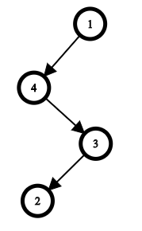
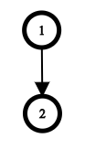
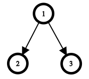

# [Codeforces Minimal Height Tree 문제 링크](https://codeforces.com/problemset/problem/1437/D)

## D. Minimal Height Tree

> **난이도:** 1600  
> **시간 제한:** 2초  
> **메모리 제한:** 256MB

Monocarp는 `n`개의 정점으로 이루어진 트리를 가지고 있었으며, 이 트리는 **1번 정점을 루트**로 한다.

그는 BFS(너비 우선 탐색)를 공부하기로 하고, 루트에서 시작하여 자신의 트리에 BFS를 실행했다.

BFS는 다음 의사 코드로 표현할 수 있다.

```python
a = [] # 정점이 처리된 순서
q = Queue()
q.put(1) # 루트를 큐의 맨 뒤에 삽입

while not q.empty():
    k = q.pop() # 큐의 맨 앞 정점을 꺼냄
    a.append(k) # 방문 순서 배열의 끝에 k를 추가

    for y in g[k]: # g[k]는 정점 k의 모든 자식을 오름차순으로 정렬한 목록
        q.put(y)
```

Monocarp는 BFS에 너무 몰두한 나머지 결국 자신의 트리를 잃어버렸다.

다행히도 BFS 알고리즘으로 정점을 방문한 순서를 나타내는 수열 `a`는 여전히 가지고 있다.

Monocarp는 모든 정점이 정확히 한 번씩 방문되었다는 사실을 알고 있다. 각 정점은 큐에 정확히 한 번 삽입되고, 정확히 한 번 꺼내졌기 때문이다.

또한 각 정점의 **자식들은 항상 정점 번호의 오름차순으로 탐색**되었다는 사실도 알고 있다.

Monocarp는 동일한 BFS 방문 순서 `a`를 가지는 트리가 일반적으로 여러 개 존재한다는 것을 알고 있으므로, 원래 트리를 복원할 생각은 없다.

대신 **높이가 최소인 트리라면 어떤 트리든 상관없다.**

트리의 높이는 모든 정점의 깊이 중 최댓값이며, 정점의 깊이는 루트에서 해당 정점까지의 경로에 있는 간선의 개수이다.

예를 들어 루트인 1번 정점의 깊이는 `0`이고, 루트의 모든 자식 정점의 깊이는 `1`이다.

Monocarp가 주어진 방문 순서 `a`를 가지면서 **높이가 최소인 트리**를 찾을 수 있도록 도와주자.

## 입력

첫 번째 줄에는 테스트 케이스의 개수 `t`가 주어진다.

- `1 ≤ t ≤ 1000`

각 테스트 케이스는 다음과 같이 구성된다.

첫 번째 줄에는 트리의 정점 개수 `n`이 주어진다.

- `2 ≤ n ≤ 2 × 10^5`

두 번째 줄에는 BFS 알고리즘으로 정점을 방문한 순서를 나타내는 `n`개의 정수 `a₁, a₂, …, aₙ`이 주어진다.

- `1 ≤ aᵢ ≤ n`
- 모든 `aᵢ`는 서로 다르다.
- `a₁ = 1`

모든 테스트 케이스에서 `n`의 합은 `2 × 10^5`를 넘지 않는다.

## 출력

각 테스트 케이스마다 주어진 BFS 방문 순서를 만족하는 트리의 **최소 가능한 높이**를 출력한다.

## 예제

**입력**

```text
3
4
1 4 3 2
2
1 2
3
1 2 3
```

**출력**

```text
3
1
1
```

## 예제 설명

### 첫 번째 테스트 케이스

주어진 방문 순서를 만족하는 트리는 단 하나뿐이다.



### 두 번째 테스트 케이스

이 경우에도 주어진 방문 순서를 만족하는 트리는 단 하나뿐이다.



### 세 번째 테스트 케이스

주어진 방문 순서를 만족하는 최적의 트리 중 하나는 다음과 같다.

