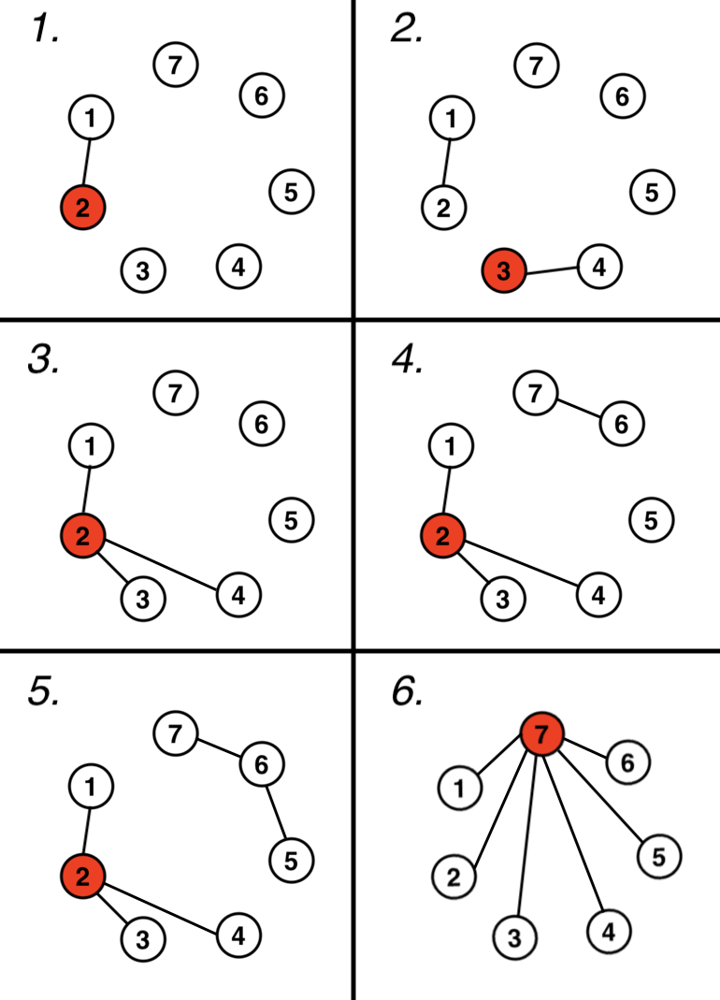

# [Codeforces Social Network 문제 링크](https://codeforces.com/problemset/problem/1609/D)

## D. Social Network

> **난이도:** 1600  
> **시간 제한:** 2초  
> **메모리 제한:** 256MB


William은 암호화폐를 주제로 한 컨퍼런스에 참가했다. 암호화폐 세계의 최신 소식을 접하기 위해서는 인맥을 형성하고, 새로운 사람들을 만나며, 친구들의 인맥을 활용하는 것이 중요하다.

컨퍼런스에는 `n`명의 참가자가 있으며, 처음에는 **서로 아는 사람이 아무도 없다.**

William은 이전에 서로 알지 못했던 두 사람 `a`와 `b`를 소개하여 서로 알게 할 수 있다.

William에게는 `d`개의 조건이 있다. `i`번째 조건은 사람 `x_i`와 `y_i`가 서로 연결되어 있어야 한다는 것이다.

두 사람 `x`와 `y`가 **연결되어 있다**는 것은 다음과 같은 사람들의 연쇄 관계가 존재한다는 의미이다.

`p₁ = x, p₂, p₃, ..., pₖ = y`

모든 `1 ≤ i ≤ k - 1`에 대해 `pᵢ`와 `pᵢ₊₁`은 서로 아는 사이여야 한다.

즉, 두 사람이 직접 아는 사이가 아니더라도 다른 사람들을 통해 이어져 있다면 연결된 것으로 간주한다.

모든 `i` (`1 ≤ i ≤ d`)에 대해 William이 다음 조건을 만족했다고 가정하자.

- 첫 번째부터 `i`번째까지의 모든 조건을 만족했다.
- 정확히 `i`번의 소개를 수행했다.
- 모든 조건은 `i`번의 소개가 끝난 후에 검사한다.

이때 **한 사람이 가질 수 있는 지인의 최대 수**를 구해야 한다.

각 `i`에 대한 정답은 독립적으로 계산한다. 즉, `i`번째 정답을 계산할 때는 처음에 아무도 서로 모르는 상태에서 시작한다고 가정해야 한다.

---

## 입력

첫 번째 줄에 두 정수 `n`, `d`가 주어진다.

- `2 ≤ n ≤ 10³`
- `1 ≤ d ≤ n - 1`

각각 참가자 수와 조건의 개수를 의미한다.

이후 `d`개의 줄에 걸쳐 두 정수 `x_i`, `y_i`가 주어진다.

- `1 ≤ x_i, y_i ≤ n`
- `x_i ≠ y_i`

이는 `i`번째 조건으로, 두 사람이 서로 연결되어 있어야 함을 의미한다.

---

## 출력

`d`개의 정수를 출력한다.

`i`번째 정수는 William이 정확히 `i`번의 소개를 수행하고, 첫 번째부터 `i`번째까지의 조건을 모두 만족했을 때, **한 사람이 가질 수 있는 지인의 최대 수**를 나타낸다.

---

## 예제 1

**입력**
```text
7 6
1 2
3 4
2 4
7 6
6 5
1 7
```

**출력**
```text
1
1
3
3
3
6
```

## 예제 2

**입력**
```text
10 8
1 2
2 3
3 4
1 4
6 7
8 9
8 10
1 4
```

**출력**
```text
1
2
3
4
5
5
6
8
```

---

## 예제 1 설명

첫 번째 예제에 대한 설명은 그림으로 제공된다.

그림에서 원과 그 안의 숫자는 각각 한 사람과 그 사람의 번호를 나타낸다. 선은 William이 두 사람을 소개하여 서로 알게 되었음을 나타낸다.

빨간색으로 표시된 사람은 가장 많은 지인을 가진 사람이다.

그림에 나타난 소개 방법만이 정답을 달성할 수 있는 유일한 방법은 아니다.

